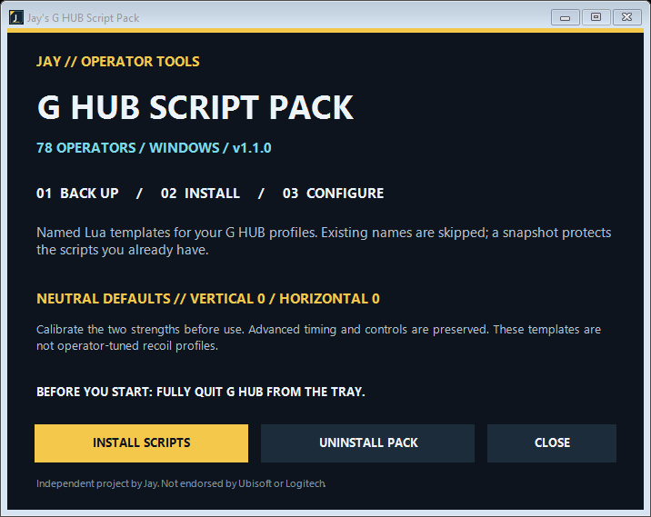

<div align="center">


# Jay's G HUB Script Pack

**A Windows installer for 78 Rainbow Six Siege operator Lua templates in Logitech G HUB.**

Keep your scripts organized. Preserve existing tuning. Start with your own calibration.

[](https://github.com/contactjayclatty/Jay-GHUB-Script-Pack/actions/workflows/validate.yml)


[Quick start](#quick-start) · [Configuration](#configure-your-script) · [All operators](#included-operators) · [Troubleshooting](#troubleshooting) · [Discussions](https://github.com/contactjayclatty/Jay-GHUB-Script-Pack/discussions)

</div>

**[DOWNLOAD INSTALLER](https://github.com/contactjayclatty/Jay-GHUB-Script-Pack/releases/download/v1.1.0/Jay-GHUB-Script-Pack-v1.1.0.exe)** · **[WINDOWS ZIP](https://github.com/contactjayclatty/Jay-GHUB-Script-Pack/releases/download/v1.1.0/Jay-GHUB-Script-Pack-v1.1.0-windows.zip)** · [Release notes & checksums](https://github.com/contactjayclatty/Jay-GHUB-Script-Pack/releases/tag/v1.1.0)

> **Jay's project release, not a Ubisoft or Logitech product.** The exact release executable is checked with Microsoft Defender on an isolated Windows runner; the [scan report](https://github.com/contactjayclatty/Jay-GHUB-Script-Pack/releases/download/v1.1.0/malware-scan-report.json) records its SHA-256 hash, engine and signature versions. This is a single-engine scan, not a guarantee of safety. The executable remains unsigned, and discovery on another G HUB installation still needs testing.

## What you get

| Organized installation | Existing work preserved | Easy to review |
| :--- | :--- | :--- |
| One named script per operator, in a unique G HUB folder. | Existing names are skipped; scripts are backed up before installation. | Lua templates, installer source, Windows CI and SHA-256 release checksums. |

- **78 operator templates**, including Noor and Solid Snake, from Ubisoft's roster checked on **22 October 2026**.
- **Neutral starting values:** both movement strengths are `0`. No personal calibration is shipped.
- **Two basic tuning fields**, with advanced timing and controls clearly separated.
- **Consistent controls:** burst-start counter resets, an idle pause, and a check that stops compensation when aim is released.
- **Uninstall that preserves edits:** only unchanged files installed by this package are removed.

These are configurable recoil-compensation templates. Operator names organize the files; they do **not** mean each script is calibrated for that operator's weapons. The installer does not activate a script, change Siege settings, or replace existing scripts.

## Quick start

### 1. Prepare G HUB

Install and open **Logitech G HUB** at least once using the Windows account that will run the scripts. Then **fully quit G HUB from the system tray**.

### 2. Run the installer

Download the `.exe` or Windows ZIP from [the v1.1.0 release](https://github.com/contactjayclatty/Jay-GHUB-Script-Pack/releases/tag/v1.1.0). Compare the file hash with `SHA256SUMS.txt` and the attached Defender scan report if you want to verify the exact artifact.

Run the installer and choose **Install scripts**. It targets the current Windows user's data automatically—no username edits or administrator access are required for the normal per-user install.

### 3. Select and configure

Reopen G HUB, open the Scripting editor for the intended profile, and select the operator script. Configure the two strength values below. With the defaults unchanged, the script produces **no mouse movement**.

**Runtime:** Windows PowerShell and .NET Framework. End users do not need Python or a .NET SDK. The executable is **unsigned** and application policies may block it.

## Configure your script

The basic section at the top of every template is:

```lua
-- USER TUNING
RcCustomStrength = 0       -- Downward movement per vertical step.
HorizontalStrength = 0     -- Negative = left; positive = right.
```

Your weapon, attachments, DPI and sensitivity affect calibration. There is no universal strength value, and this project does not claim measured recoil accuracy for all operators.

<details>
<summary><strong>Advanced settings — normally leave these alone</strong></summary>

| Setting | Default | Purpose |
| :--- | :---: | :--- |
| `EnableRCS` | `true` | Enables the logic; zero strengths still mean no movement. |
| `RecoilControlMode` | `"Custom"` | Uses the strength entered in the basic section. |
| `VerticalFrequency` | `2` | Vertical step every two firing-loop iterations. |
| `HorizontalFrequency` | `4` | Horizontal step every four firing-loop iterations. |
| `DelayRate` | `7` | Requested firing-loop sleep in milliseconds. Actual timing can vary. |
| `RequireToggle` | `true` | Requires the configured lock key before entering the aim loop. |
| `ToggleKey` | `"CapsLock"` | Lock key used for activation. |

The two firing branches remain separate. Both counters reset at each burst. `Sleep(1)` runs while aiming without firing. The firing loop exits when fire or aim is released. Caps Lock is checked before entering the aim loop, not continuously while inside it.

These are guidance comments, not locked settings. Changing timing changes how existing strength values behave.

</details>

## Installer preview



This is a local rendering of the real Windows Forms interface. It verifies layout, not another PC's G HUB discovery.

## What gets installed?

```text
%LOCALAPPDATA%\LGHUB\
├── scripts\
│   ├── <unique operator ID>\
│   │   ├── config.json     # Display name in G HUB
│   │   └── script.lua      # Operator template
│   └── ...
└── script-pack-installs\
    └── siege-operator-lua-pack-v1\
        ├── installed.json # Ownership and hashes for uninstall
        └── backups\
            └── <timestamp>\
                └── scripts\
```

**Already have scripts?** Matching names are skipped—even if the contents differ. Older names such as `Jager` and `Valk` are recognized as aliases for `Jäger` and `Valkyrie`. Unrelated scripts stay in place. Existing scripts are not automatically updated.

## Included operators

<!-- operators:begin -->
<details>
<summary><strong>View all 78 operators</strong></summary>

| Operator | Operator | Operator |
| :--- | :--- | :--- |
| Ace | Alibi | Amaru |
| Aruni | Ash | Azami |
| Bandit | Blackbeard | Blitz |
| Brava | Buck | Capitão |
| Castle | Caveira | Clash |
| Deimos | Denari | Doc |
| Dokkaebi | Echo | Ela |
| Fenrir | Finka | Flores |
| Frost | Fuze | Glaz |
| Goyo | Gridlock | Grim |
| Hibana | IQ | Iana |
| Jackal | Jäger | Kaid |
| Kali | Kapkan | Lesion |
| Lion | Maestro | Maverick |
| Melusi | Mira | Montagne |
| Mozzie | Mute | Nomad |
| Noor | Nøkk | Oryx |
| Osa | Pulse | Ram |
| Rauora | Rook | Sens |
| Sentry | Skopós | Sledge |
| Smoke | Solid Snake | Solis |
| Striker | Tachanka | Thatcher |
| Thermite | Thorn | Thunderbird |
| Tubarão | Twitch | Valkyrie |
| Vigil | Wamai | Warden |
| Ying | Zero | Zofia |

</details>
<!-- operators:end -->

Source: [Ubisoft's operator directory](https://www.ubisoft.com/en-us/game/rainbow-six/siege/game-info/operators), checked **22 October 2026**. The [catalog](payload/catalog.json) records names, aliases and hashes.

## Uninstall or recover

**Uninstall:** quit G HUB, run the installer again, and choose **Uninstall pack**. It removes unchanged scripts recorded as belonging to this package. Modified scripts, unrelated scripts and backup snapshots remain.

**Recover:** with G HUB closed, copy the specific script folders you need from a snapshot's `scripts` directory back into `%LOCALAPPDATA%\LGHUB\scripts`. See [README.txt](README.txt) for the backup location and full instructions.

## Troubleshooting

| What happens | What to check |
| :--- | :--- |
| Installer asks you to close G HUB | Quit its tray icon. If processes remain, close `lghub` and `lghub_agent` in Task Manager, then retry. |
| G HUB user data is not found | Open G HUB once under the same Windows account, then fully quit it. |
| An operator is skipped | A matching name or alias already exists and was left unchanged. |
| The script loads but does nothing | Both strengths default to `0`. Check the selected profile and Caps Lock too. |
| Scripts do not appear | Restart G HUB and check its Scripting editor. If still missing, report Windows/G HUB versions and the install result; cross-install discovery is still being validated. |
| Uninstall leaves a script behind | Its files or folder contents changed. It was preserved to protect your edits. |

[Report an installation bug](https://github.com/contactjayclatty/Jay-GHUB-Script-Pack/issues/new?template=bug_report.yml) · [Ask a setup question](https://github.com/contactjayclatty/Jay-GHUB-Script-Pack/discussions)

## Verified behavior and remaining checks

| Check | Evidence |
| :--- | :--- |
| Fresh and repeat installation | Automated tests |
| Existing-name, alias and Unicode handling | Automated tests |
| Backup retention and preservation of edited scripts | Automated tests |
| Ownership-aware uninstall and corrupt-payload rejection | Automated tests |
| Payload hashes and Windows executable build | Windows CI |
| Exact release executable and extracted payload malware scan | Microsoft Defender report attached to the release |
| Lua syntax for all 78 templates | Checked locally |
| Installer UI and discovery on another G HUB install | **Still needs testing** |

See [test scope and manual test steps](docs/testing.md). A passing build does not guarantee compatibility with every G HUB version.

## Build from source

On Windows, install **Git** and **Python 3** for development. Building uses Windows PowerShell and the .NET Framework C# compiler.

```powershell
git clone https://github.com/contactjayclatty/Jay-GHUB-Script-Pack.git
cd Jay-GHUB-Script-Pack
python test_installer.py
powershell -NoProfile -ExecutionPolicy Bypass -File .\build.ps1
```

The executable is written to `dist/`. Tests use temporary project folders and do not modify live G HUB scripts. Building uses the committed payload and does not read your personal scripts.

To regenerate templates, see [maintainer architecture](docs/architecture.md). Generation additionally needs the Lua compiler, with its developer tool path configured for your machine.

## Help improve the pack

The most useful contributions right now are **real installation reports**: Windows version, G HUB version, whether names appear correctly, and whether edited scripts survive uninstall. See [the roadmap](docs/roadmap.md) and [contribution guide](CONTRIBUTING.md).

Use **Issues** for reproducible bugs and **Discussions** for setup questions and ideas. If the project saves you time, a star helps you keep track of it and shows Jay that it is useful.

---

Made by **[Jay](https://github.com/contactjayclatty)**. Independent of Logitech and Ubisoft; names identify compatibility and the roster. No source license grant is included pending the owner's licensing decision.
