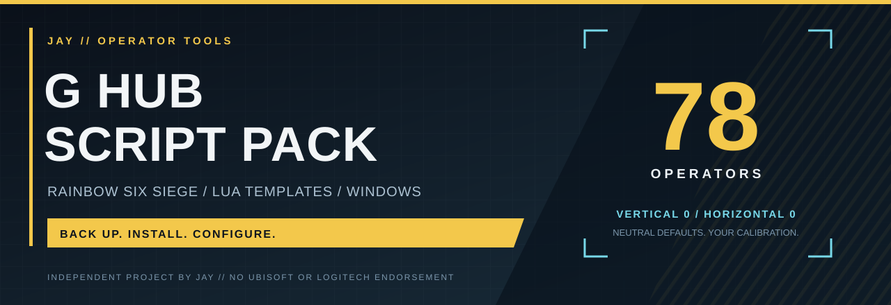
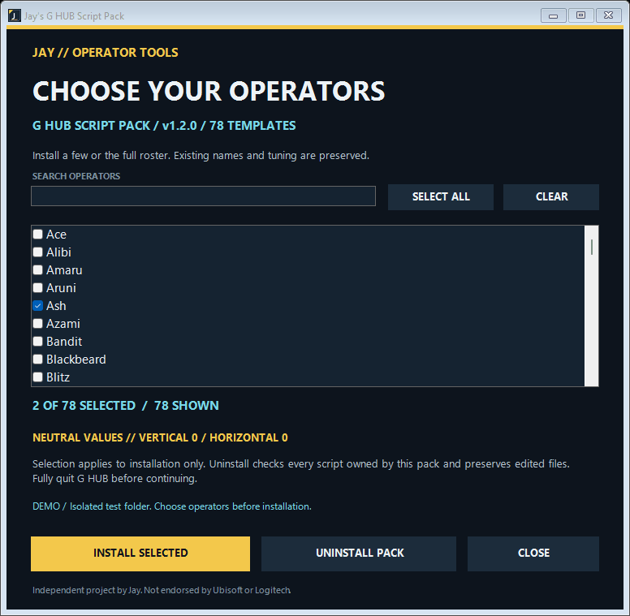

<div align="center">



# Jay's G HUB Script Pack

**78 Siege operators. One installer. Your own tuning.**

Choose the operators you want. Install their Lua templates into Logitech G HUB with backups and edit-preserving uninstall.

[](https://github.com/contactjayclatty/Jay-GHUB-Script-Pack/releases/download/v1.2.0/Jay-GHUB-Script-Pack-v1.2.0.exe)
[](https://github.com/contactjayclatty/Jay-GHUB-Script-Pack/releases/download/v1.2.0/Jay-GHUB-Script-Pack-v1.2.0-windows.zip)

[](https://github.com/contactjayclatty/Jay-GHUB-Script-Pack/releases/latest)
[](https://github.com/contactjayclatty/Jay-GHUB-Script-Pack/actions/workflows/validate.yml)
[](LICENSE)
[](https://github.com/contactjayclatty/Jay-GHUB-Script-Pack/releases/download/v1.2.0/malware-scan-report.json)

[Install](#install-in-three-steps) · [Configuration](docs/configuration.md) · [All operators](#operator-roster) · [Help](docs/setup.md#troubleshooting) · [Release notes](https://github.com/contactjayclatty/Jay-GHUB-Script-Pack/releases/tag/v1.2.0)

</div>

> **Starts at zero.** Every template ships with vertical and horizontal strengths set to `0`. Set your own values before expecting mouse movement. Operator names organize the pack; they are not pre-calibrated weapon profiles.

## Built around your existing setup

| 78 named templates | Existing scripts stay yours | Backups before installation |
| :--- | :--- | :--- |
| A separate entry for each operator in G HUB. | Matching names and older aliases are skipped. | Current scripts are copied to a dated snapshot. |

Only two strength values sit in the basic configuration section. Advanced timing and controls are kept separate. Burst resets, idle pauses and aim-release checks are included in every template.

## Install in three steps

**1 · Close G HUB**

Open G HUB at least once on this Windows account, then fully quit it from the system tray.

**2 · Choose your operators**

Run [the installer](https://github.com/contactjayclatty/Jay-GHUB-Script-Pack/releases/download/v1.2.0/Jay-GHUB-Script-Pack-v1.2.0.exe) and check the operators you want. Use search, **Select All** or **Clear**, then choose **Install selected**. It finds the current user's G HUB folder automatically. Existing operator names are skipped.

**3 · Select and configure**

Reopen G HUB, select the operator script in the Scripting editor for your profile, then set your strengths. The installer does not activate a script for you.

[Full setup guide →](docs/setup.md)

## The installer



*Real Windows Forms UI and real install/uninstall results in an isolated test folder. This is not a recording of G HUB.*

## Two values to configure

```lua
RcCustomStrength = 0       -- Downward movement per vertical step.
HorizontalStrength = 0     -- Negative = left; positive = right.
```

Keep the advanced settings unchanged unless you understand their effect. Calibration depends on the weapon, attachments, DPI and sensitivity; there is no universal strength value.

[Configuration reference →](docs/configuration.md)

## Operator roster

<!-- operators:begin -->
<details>
<summary><strong>View all 78 operators</strong></summary>

| Operator | Operator | Operator |
| :--- | :--- | :--- |
| Ace | Alibi | Amaru |
| Aruni | Ash | Azami |
| Bandit | Blackbeard | Blitz |
| Brava | Buck | Capitão |
| Castle | Caveira | Clash |
| Deimos | Denari | Doc |
| Dokkaebi | Echo | Ela |
| Fenrir | Finka | Flores |
| Frost | Fuze | Glaz |
| Goyo | Gridlock | Grim |
| Hibana | IQ | Iana |
| Jackal | Jäger | Kaid |
| Kali | Kapkan | Lesion |
| Lion | Maestro | Maverick |
| Melusi | Mira | Montagne |
| Mozzie | Mute | Nomad |
| Noor | Nøkk | Oryx |
| Osa | Pulse | Ram |
| Rauora | Rook | Sens |
| Sentry | Skopós | Sledge |
| Smoke | Solid Snake | Solis |
| Striker | Tachanka | Thatcher |
| Thermite | Thorn | Thunderbird |
| Tubarão | Twitch | Valkyrie |
| Vigil | Wamai | Warden |
| Ying | Zero | Zofia |

</details>
<!-- operators:end -->

Checked **22 October 2026** against [Ubisoft's operator directory](https://www.ubisoft.com/en-us/game/rainbow-six/siege/game-info/operators). Includes Noor and Solid Snake. [Names, aliases and hashes](payload/catalog.json) are recorded in the catalog.

## Backups and uninstall

Scripts install into `%LOCALAPPDATA%\LGHUB\scripts`, one UUID folder per operator. The Windows username does not need to be entered manually.

To uninstall, quit G HUB and run the installer again. Only unchanged scripts installed by this pack are removed. Edited scripts, unrelated scripts and backup snapshots remain.

[Folder structure and recovery →](docs/setup.md#backups-and-recovery)

## Download verification

The published v1.2.0 executable and extracted payload were scanned by **Microsoft Defender: no threats detected**. The report identifies the exact executable hash, signature versions and scan time.

[Scan report](https://github.com/contactjayclatty/Jay-GHUB-Script-Pack/releases/download/v1.2.0/malware-scan-report.json) · [SHA-256 checksums](https://github.com/contactjayclatty/Jay-GHUB-Script-Pack/releases/download/v1.2.0/SHA256SUMS.txt) · [Windows build and scan](https://github.com/contactjayclatty/Jay-GHUB-Script-Pack/actions/workflows/validate.yml)

The executable is **unsigned**. A single-engine scan is not a safety guarantee. Installer tests pass in isolated folders; installation on another PC has been confirmed by the maintainer. The Windows/G HUB versions were not recorded, and v1.2.0 selection still needs separate-PC testing. See [testing](docs/testing.md) for the exact scope.

## Build it yourself

Windows development requirements: Git, Python 3, Windows PowerShell and the .NET Framework C# compiler. End users do not need Python or a .NET SDK.

```powershell
git clone https://github.com/contactjayclatty/Jay-GHUB-Script-Pack.git
cd Jay-GHUB-Script-Pack
python test_installer.py
powershell -NoProfile -ExecutionPolicy Bypass -File .\build.ps1
```

The executable is written to `dist/`. Tests use isolated directories and leave live G HUB scripts alone.

[Developer guide](docs/architecture.md) · [Contributing](CONTRIBUTING.md) · [Changelog](CHANGELOG.md)

## Questions, bugs and ideas

[Discussions](https://github.com/contactjayclatty/Jay-GHUB-Script-Pack/discussions) are for setup questions and ideas. For a reproducible problem, use the [bug report form](https://github.com/contactjayclatty/Jay-GHUB-Script-Pack/issues/new?template=bug_report.yml).

The most helpful reports include Windows and G HUB versions, selected operators, the install result, and whether edited scripts survive uninstall. See [what's next](docs/roadmap.md).

**Finding it useful? [Star the repo](https://github.com/contactjayclatty/Jay-GHUB-Script-Pack) so you can find it again.**

---

[Jay](https://github.com/contactjayclatty) · Independent project. Not affiliated with Ubisoft or Logitech. [MIT licensed](LICENSE).
